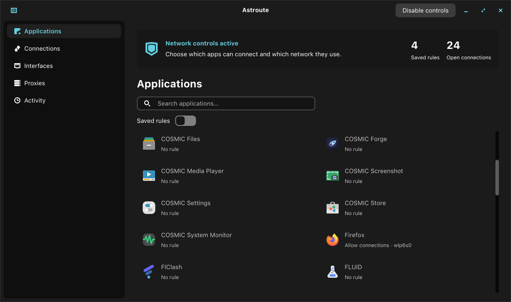

<p align="center">
  
</p>

# Astroute

Per-application network controls for the COSMIC desktop, built with Rust and libcosmic.



- Allow, block or restrict apps to the local network.
- Choose a Wi-Fi, Ethernet or VPN interface; disconnecting keeps traffic blocked.
- Assign SOCKS5, HTTP or HTTPS proxies with optional direct fallback on the selected interface.
- Inspect connections, save rules without root and manage controls from the system tray.

## Install

Linux x86_64: Pop!_OS/Ubuntu 24.04+, Arch Linux and Fedora.

```sh
curl -fsSL https://raw.githubusercontent.com/cosmic-utils/astroute/main/install.sh | bash
```

The installer downloads the latest package, verifies its checksum and installs dependencies
through your package manager. Native `.deb`, `.pkg.tar.zst` and `.rpm` packages are also
available under [Releases](https://github.com/cosmic-utils/astroute/releases).
Quit Astroute before updating or removing it with your package manager.

## Use

Select an app to save its rule in the right sidebar, then **Enable controls** to authenticate.
Fully quit existing app processes and relaunch through Astroute or the managed app-library
entry to enforce rules from startup. Direct or alternate launches are detected after startup.
Unsupported apps, including Flatpaks, are hidden.

**Settings** includes startup at login, manual update checks and the installed version.

In **Interfaces**, choose a system default for IPv4 or IPv6 from interfaces with a usable
default route. VPN and per-app routing rules keep their priority. **Automatic** removes
the preference, which also clears on reboot.

Closing the window keeps the tray running. If the tray is unavailable, the window minimizes.
**Quit Astroute** or **Ctrl+Q** disables controls before exiting. Cleanup errors keep the app open.

Editing a proxy marks affected rules pending for **Apply saved rules**. Proxy tests are
available beside saved profiles and use Cloudflare's HTTPS endpoint.

Requires cgroup v2, cgroup BPF links, nftables and polkit. Shared resolvers, portals and services
follow their own network policy. Astroute is not a sandbox for hostile applications.

## Build

Install the [libcosmic build dependencies](https://github.com/pop-os/libcosmic#building) and Rust 1.93+.

```sh
cargo build --release --workspace --locked
./target/release/astroute
sudo ./target/release/astroute-install
```

Release packaging is described in [packaging](packaging/README.md).
Follows the [COSMIC app template](https://github.com/pop-os/cosmic-app-template). GPL-3.0-only.
